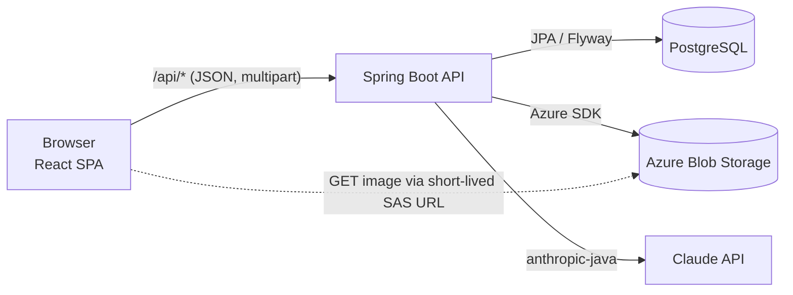

# Architecture

## Overview

- The **frontend** is a single-page app. It talks only to the backend and loads images directly from Blob Storage using short-lived, read-only SAS URLs that the backend generates.
- The **backend** is the only component that holds secrets: database credentials, JWT key, Azure connection string and Claude API key.
- **PostgreSQL** stores users, refresh tokens, clothing metadata and outfits. Flyway owns the schema, and Hibernate only validates it.
- **Azure Blob Storage** holds the clothing images in a private container. The database stores only the blob name.

## Backend packages (`com.fitcheck`)

Code is grouped by feature, not by layer:

| Package | Responsibility |
|---|---|
| `config` | Security, CORS, Azure and Anthropic client beans, typed properties |
| `auth` | Register/login/refresh/logout, JWT issuing and validation, refresh-token rotation |
| `user` | User entity and account endpoints |
| `clothing` | Clothing item entity, upload/list/update/delete |
| `outfit` | Outfits and their items |
| `storage` | Azure Blob Storage wrapper (upload, delete, SAS URLs) |
| `ai` | Claude-powered outfit suggestions |
| `common` | Shared exceptions and error responses |

Within a feature, requests flow Controller → Service → Repository. DTOs live in each feature's `dto` subpackage, and entities are never returned directly from controllers.

## Frontend structure (`frontend/src`)

| Folder | Responsibility |
|---|---|
| `api/` | axios instance (`client.ts`) with access-token injection and refresh-on-401, plus one module per resource |
| `context/`, `hooks/` | Auth state (`AuthProvider`, `useAuth`) |
| `routes/` | `ProtectedRoute` guard |
| `pages/` | Route components: Login, Register, Wardrobe, ClothingDetail, Plan, NotFound |
| `components/` | `layout/`, `wardrobe/`, `plan/` building blocks |
| `types/` | TypeScript mirrors of backend DTOs |

## Key flows

### Uploading a clothing item
1. The user picks a photo and enters metadata in `UploadClothingModal`.
2. The frontend sends `POST /api/clothing` as multipart (`image` + `metadata`).
3. `ClothingService` checks the file type and size, and `BlobStorageService` uploads it as `users/{userId}/{uuid}.{ext}`.
4. The service saves a `clothing_items` row with the `blob_name`.
5. The response includes an `imageUrl`, a SAS URL valid for about 15 minutes.

### Browsing
`GET /api/clothing?category=TOP` returns the user's items, each with a fresh SAS URL.

### AI outfit suggestions
1. In plan mode, `AiPromptPanel` sends `POST /api/ai/outfit-suggestions` with a text prompt, an optional inspiration image, or both.
2. `OutfitSuggestionService` loads the user's wardrobe metadata, builds a Claude request (text + image blocks, structured output schema) and calls the Claude API.
3. The backend checks that every returned item ID belongs to the user before returning suggestions.
4. The user can apply a suggestion to the outfit canvas and save it as an outfit.

Details are in [AI_INTEGRATION.md](AI_INTEGRATION.md).

### Authentication
Short-lived JWT access tokens are kept in memory, and rotating refresh tokens are stored in an HttpOnly cookie. See [AUTH.md](AUTH.md).

## Deployment (planned)

- Frontend: Azure Static Web Apps, or a static build served by the backend.
- Backend: Azure App Service or Azure Container Apps.
- Database: Azure Database for PostgreSQL – Flexible Server.
- Secrets: App settings / Azure Key Vault.
