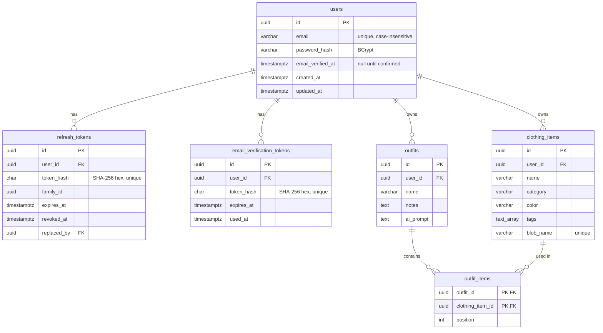

# Database

PostgreSQL 16. Flyway applies the migrations in `backend/src/main/resources/db/migration` when the backend starts. Hibernate runs with `ddl-auto: validate` and never changes the schema.

**Rule:** never edit a migration after it has run anywhere. Add `V2__description.sql`, `V3__...`, and so on.

## Entity relationships

## Notes

- **IDs** are UUIDs generated by Postgres (`gen_random_uuid()`), so IDs can't be guessed.
- **Ownership:** every user-owned table has a `user_id`. Every query in a service must filter by the current user's ID.
- **Cascades:** deleting a user deletes their tokens, items and outfits. Deleting a clothing item removes it from outfits. The backend must delete the matching blobs in Azure.
- **Images:** only `blob_name` is stored. Image URLs are generated per request as short-lived SAS links.
- **Categories:** the `CHECK` constraint must match the `ClothingCategory` Java enum and the TypeScript type.
